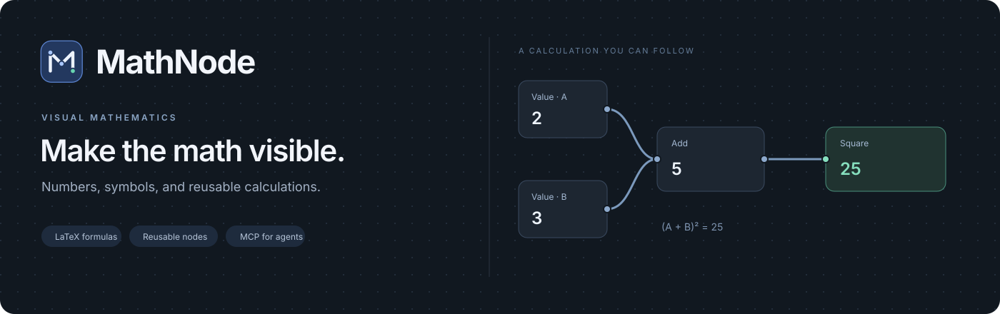
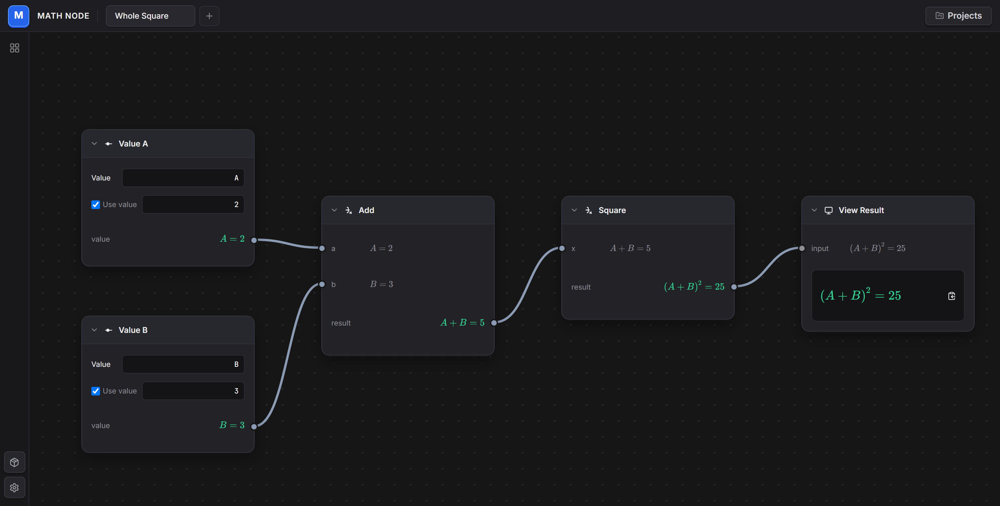
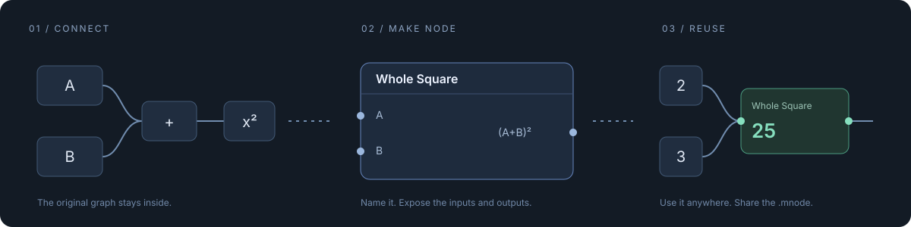
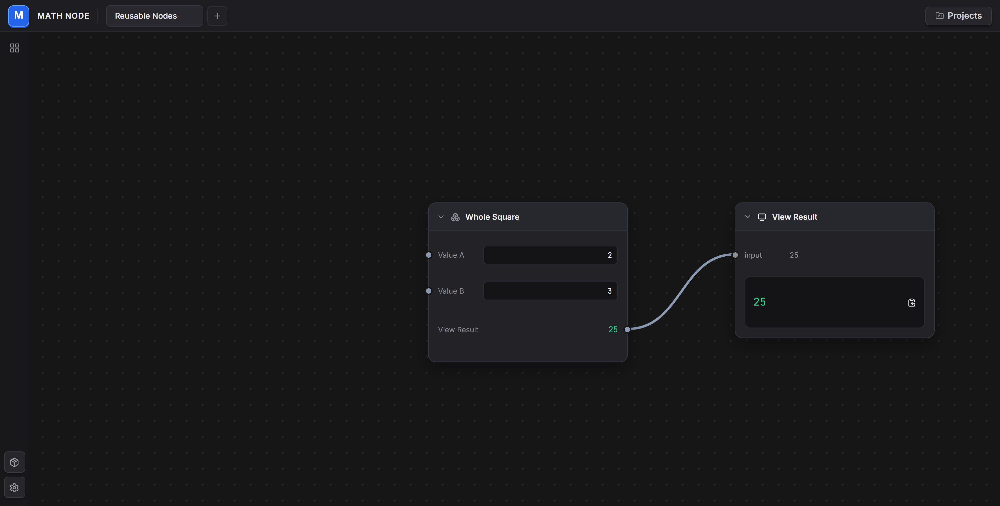
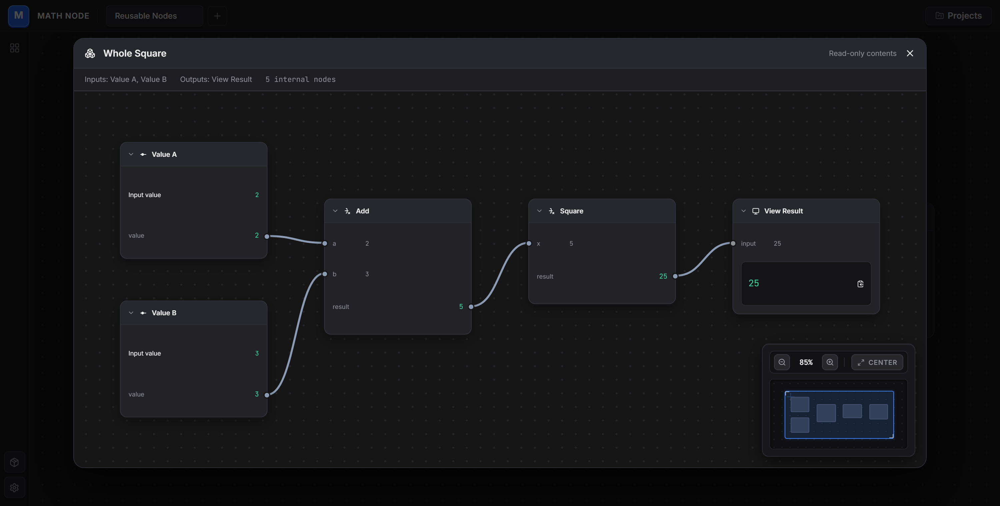
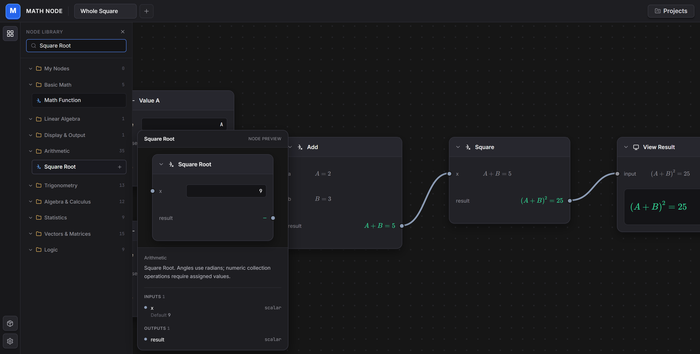
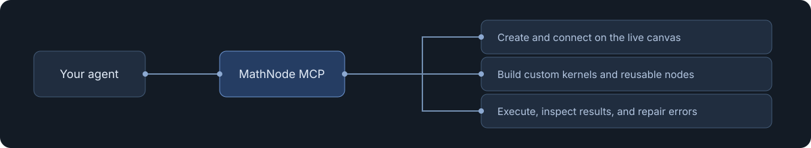

<p align="center">
  
</p>

<p align="center">
  <a href="https://github.com/arunmauryaz/MathNode/actions/workflows/ci.yml"></a>
  
  
  
</p>

<p align="center">
  <a href="#the-canvas">See it work</a> ·
  <a href="#run-locally">Run locally</a> ·
  <a href="docs/MCP_AGENT_GUIDE.md">Connect an agent</a> ·
  <a href="docs/NODE_AUTHORING.md">Build a node</a>
</p>

## The canvas

Numbers and symbols use the same **Value** node. Connect the calculation; see the formula and result together.

<a href="docs/assets/canvas.png"></a>

## Keep the calculation

Turn a connected selection into one reusable node. Its wiring stays inside. Export a `.mnode` and share it.



<table>
  <tr>
    <td width="50%"><a href="docs/assets/prefab.png"></a></td>
    <td width="50%"><a href="docs/assets/inside-node.png"></a></td>
  </tr>
  <tr>
    <td align="center"><sub>Use it like any other node.</sub></td>
    <td align="center"><sub>Open it to inspect every step.</sub></td>
  </tr>
</table>

## Find the next step

Preview a node's controls and connections before adding it. The library covers arithmetic, trigonometry, algebra, calculus, statistics, vectors, matrices, and logic.

<a href="docs/assets/library.png"></a>

## Run locally

**Node.js 22.3+ · npm 10.5+**

```sh
git clone https://github.com/arunmauryaz/MathNode.git
cd MathNode
npm ci
npm run dev
```

Open **http://localhost:3000**. On Windows, `run.bat` also starts the app.

## For agents

An MCP agent can create graphs, connect nodes, execute calculations, inspect errors, and build custom kernels or reusable nodes. Live canvas updates include revision checks, undo, and conflict detection.



[Set up MCP →](docs/MCP_AGENT_GUIDE.md) · [Example configuration →](mcp/mcp-config.example.json)

## Explore

| | |
| :--- | :--- |
| **Try a formula** | [LaTeX workspace](examples/latex_formula.mathnode) · [Symbolic whole square](examples/symbolic_whole_square.mnode) |
| **Get the library** | [93 portable nodes](library/standard) · [Download ZIP](library/MathNode-Standard.zip) |
| **Make your own** | [Node SDK & format](docs/NODE_AUTHORING.md) |
| **Go deeper** | [Project reference](docs/REFERENCE.md) · [Design guide](mathnode-design-guide.md) |

<sub>Mathematical DAGs with real-number evaluation and symbolic formulas. Equation nodes represent equalities; they are not a universal solver. Run only trusted custom kernels. This project is under active development.</sub>
