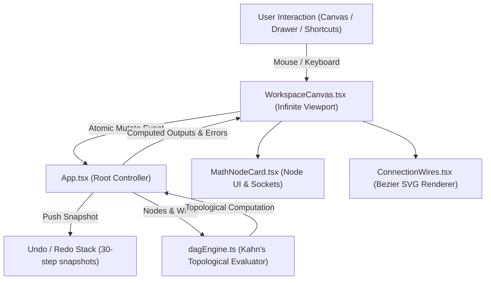

> Detailed project reference. See the [visual overview](../README.md) for a quick introduction.

# MathNode 📐⚡

> **A high-performance, modular, node-based visual mathematical computing environment.**  
> Designed with a reactive Directed Acyclic Graph (DAG) computation engine, extensible `.mnode` soft-coded operator architecture, tactile infinite canvas, and a full suite of professional graph micro-features.

---

## 🌟 1. Project Overview & Philosophy

**MathNode** is a modern visual programming workspace for mathematics, algorithmic computing, and scientific exploration. Instead of writing monolithic scripts or working with rigid static calculators, users construct computational pipelines by wiring together mathematical operators on an infinite, interactive canvas.

### Core Design Principles

1. **Soft-Coded, Dynamic Node Architecture**:  
   Nodes are **never hardcoded** into rigid UI views. Every node is defined by a data specification (`NodeDefinition` / `.mnode`) that specifies:
   - Metadata (name, category, icon, description, badges).
   - Typed sockets (scalar, vector, matrix, calculus, bool, etc.).
   - Interactive widgets (numeric inputs, sliders, matrix grids, dropdowns).
   - A worker-executed JavaScript mathematical compute kernel (`inputs => outputs`).

2. **Reactive Topological DAG Execution**:  
   Whenever values, definitions, or connections change, a Web Worker topologically evaluates the graph (Kahn's algorithm). Cached kernels and resolved-input fingerprints reuse unaffected results; moving or resizing nodes does not run computation.

3. **Atomic State & Zero Race Conditions**:  
   All graph structural transitions (node additions, deletions, cuts, pastes, duplicates, wiring) execute as single atomic mutations via `handleMutateGraph`. This prevents asynchronous React closure staleness and ensures deleted nodes or detached wires are never inadvertently resurrected.

4. **Extensible File Formats**:  
   - **`.mnode`**: Portable JSON format representing individual custom node operator definitions and their executable kernels.
   - **`.mathnode`**: Full graph workspace files saving nodes, coordinates, dimensions, parameters, wire topologies, viewport state, and frames.
   - **`.zip` Packages**: Bundles containing entire libraries and folder trees of `.mnode` definitions.

---

## 🚀 2. Technology Stack

- **Frontend Framework**: [React](https://react.dev/) (Functional components, hooks, custom state management).
- **Language**: [TypeScript](https://www.typescriptlang.org/) (Strict type safety across the graph, sockets, and DAG engine).
- **Styling**: [Tailwind CSS](https://tailwindcss.com/) (Dark-mode tactile UI inspired by modern creative tooling like ComfyUI, Blender, and Unreal Engine).
- **Icons**: [Lucide React](https://lucide.dev/) (Clean, modern SVG iconography + custom mathematical glyphs).
- **Bundler & Dev Server**: [Vite](https://vitejs.dev/) (Instant HMR, production build bundling).
- **Package Archives**: [JSZip](https://stuk.github.io/jszip/) (In-browser `.zip` package reading and extraction).

---

## 🏗️ 3. Architecture & System Design



### 3.1. Directory Structure

```
d:\MATHNODE\
├── docs\
│   └── superpowers\
│       └── plans\              # Architectural implementation plans & checklists
├── public\                     # Static assets and icons
├── src\
│   ├── components\
│   │   ├── layout\             # Primary UI shells and canvas
│   │   │   ├── LeftRail.tsx            # Left 44px utility sidebar (Library, Packages, Settings)
│   │   │   ├── NavigatorMinimap.tsx    # Tactile bottom-right minimap with pan/zoom controls
│   │   │   ├── NodeLibraryDrawer.tsx   # Sliding drawer for browsing & dragging nodes onto canvas
│   │   │   ├── TopBar.tsx              # Multi-project tabs, tab actions, and application menu
│   │   │   └── WorkspaceCanvas.tsx     # Infinite canvas, event bus, marquee, clipboard, spotlight
│   │   ├── menu\
│   │   │   └── AppMenu.tsx             # Root 'M' branding menu (New, Open, Save)
│   │   ├── modals\
│   │   │   ├── PackageManagerModal.tsx # Node library manager, folder hierarchy, zip/mnode import
│   │   │   ├── ProjectManagerModal.tsx # Project switcher, templates, recent graphs, startup settings
│   │   │   └── SettingsModal.tsx       # Grid dot spacing, wire thickness, minimap, auto-save settings
│   │   └── nodes\
│   │       ├── ConnectionWires.tsx     # Pixel-perfect Bezier curves, hover glow, click-to-disconnect
│   │       ├── MathIcon.tsx            # Mathematical SVG symbols (sigma, delta, pi, matrix, etc.)
│   │       └── MathNodeCard.tsx        # Dynamic node card renderer, 4-corner resizing, socket dots
│   ├── types\
│   │   └── index.ts            # Core TypeScript interfaces, sockets, graphs, clipboard, history
│   ├── utils\
│   │   ├── dagEngine.ts        # Reactive topological graph evaluator (Kahn's Algorithm)
│   │   ├── defaultNodes.ts     # Built-in mathematical node definitions & initial demo graph
│   │   ├── nodeParser.ts       # .mnode JSON importer and validator
│   │   └── socketGeometry.ts   # Exact socket Y-offsets & minimum card dimension calculations
│   ├── App.tsx                 # Central state coordinator, DAG lifecycle, modal routing
│   ├── index.css               # Global canvas dot-grid styles and dark-mode tokens
│   └── main.tsx                # React application entry point
├── package.json
├── tsconfig.json
└── vite.config.ts
```

---

## ⚡ 4. Reactive DAG Computation Engine (`dagEngine.ts`)

At the heart of MathNode is an in-browser reactive DAG evaluator:

1. **Graph Construction**: Converts active nodes and connections into an adjacency list and in-degree map.
2. **Topological Sorting**: Evaluates using Kahn's algorithm. Connections that create cycles are rejected. Imported cycles and their dependents receive explicit errors instead of arbitrary evaluation.
3. **Data Propagation**: For each node in topological order:
   - Base inputs are initialized from the node's custom widget values or fallback defaults.
   - Connected inputs are overwritten with the computed outputs of upstream parent nodes.
4. **Worker Kernel Execution**: Executes kernels off the UI thread with a two-second graph deadline. Both function expressions and function-body kernels are supported:
   ```javascript
   (inputs, math) => {
     const a = Number(inputs.a ?? 0);
     const b = Number(inputs.b ?? 0);
     return { result: a + b };
   }
   ```
5. **Live Error Trapping**: Any division by zero, matrix dimension mismatch, or runtime script error is caught and mapped to `node.error`, surfacing a clean warning badge on the node without crashing the application.

---

## 🎛️ 5. Canvas Micro-Features & Keyboard Shortcuts

MathNode features an enterprise-grade node interaction suite modeled after professional digital audio workstations (DAWs) and visual shader graphs:

| Shortcut / Action | Action Description | Behavior Details |
| :--- | :--- | :--- |
| **`Delete` / `Backspace`** | Delete Selected Nodes | Atomically removes selected nodes and all connected wires. |
| **Header Trash Icon** | Delete Node | Directly deletes the hovered/selected node. |
| **`Ctrl + C`** | Copy Selection | Copies selected nodes and internal connections between them to clipboard. |
| **`Ctrl + X`** | Cut Selection | Copies selected nodes and internal wires, then deletes them from graph. |
| **`Ctrl + V`** | Paste at Cursor | Generates fresh unique IDs, remaps internal wires, and pastes at mouse cursor. |
| **`Ctrl + D`** | Duplicate | Duplicates selection offset by `+36px, +36px` while preserving internal wires. |
| **`Ctrl + A`** | Select All Nodes | Selects every node on the current canvas. |
| **`Escape`** | Cancel / Deselect | Cancels active wire drag -> closes spotlight/menu -> deselects all nodes. |
| **`Ctrl + Z`** | Undo | Restores the previous graph state from the 30-step history stack. |
| **`Ctrl + Y` / `Ctrl+Shift+Z`** | Redo | Reapplies undone graph transformations. |
| **Double-Click Canvas** | Spotlight Quick-Add | Opens a floating search popup under cursor to spawn nodes instantly. |
| **Double-Click Title** | Inline Rename | Double-click any node's title to rename it inline. Press Enter or blur to save. |
| **Rubber-Band Drag** | Marquee Selection | Click and drag on empty canvas to select all intersecting nodes. |
| **`Shift + Click` / `Ctrl + Click`** | Multi-Select Toggle | Adds or removes a node from the selection set. |
| **Group Dragging** | Synchronized Move | Dragging any selected node moves all selected nodes together. |
| **`F` Key** | Frame Selection | Smoothly centers and zooms viewport to fit selected nodes (or entire graph). |
| **`Home` or `0`** | Reset Focus | Re-centers canvas at 100% zoom. |
| **`Space + Drag` / MMB** | Canvas Panning | Pans the infinite canvas smoothly. |
| **Mouse Wheel** | Anchor-Centered Zoom | Zooms in/out anchored to the mouse pointer position (0.2x to 3.0x). |
| **Wire Click / Right-Click** | Select / Actions | Click selects with an outline; Delete disconnects. Right-click offers Copy, Disconnect, and Insert Node. |
| **4-Corner Drag** | Freeform Node Resizing | Drag any corner (`tl`, `tr`, `bl`, `br`) to resize; anchors opposite corner. |

> **Input Immunity Safeguard**: Every single keyboard shortcut checks `document.activeElement`. Typing in parameter fields, textareas, or node title editors **never** triggers accidental node deletion or copy/paste actions.

---

## 📦 6. Default Node Library

MathNode ships with a set of modular, soft-coded default operators:

| Node ID | Node Name | Category | Inputs / Controls | Outputs | Description |
| :--- | :--- | :--- | :--- | :--- | :--- |
| `math.value` | **Value** | Basic Math | Number, symbol or LaTeX; optional numerical binding; no input sockets | `value` (scalar) | Unified source with numeric slider. Legacy Variable nodes migrate automatically. |
| `math.equation` | **Equation** | Basic Math | `left`, `right` (scalar) | `equation` | Builds an equality from two numbers or expressions. |
| `math.operations` | **Math Operation** | Basic Math | `a`, `b`, `operation` | `result` (scalar) | Binary operator: `+`, `-`, `*`, `/`, `^`, `%`. |
| `math.output` | **View Result** | Display & Output | `input` (any) | *None* | Terminal inspector for scalars, vectors, matrices, strings, and booleans. |
| `math.function` | **Math Function** | Basic Math | `x`, `func` | `result` (scalar) | Unary functions: `sin`, `cos`, `tan`, `sqrt`, `abs`, `ln`, `exp`, `x²`. |
| `math.constant` | **Constant** | Basic Math | `constant` | `value` (scalar) | Exact mathematical constants: $\pi$, $e$, $\phi$, $\sqrt{2}$. |
| `math.matrix_mul` | **Matrix Multiply** | Linear Algebra | `A`, `B` (matrix) | `C` (matrix) | 2x2 matrix multiplication with interactive grid inputs. |

---

## 📄 7. File Formats & Schemas

### 7.1. `.mnode` Operator Schema
Used to distribute and install custom mathematical nodes into the library:

```json
{
  "id": "custom.vector_dot",
  "name": "Vector Dot Product",
  "category": "Linear Algebra",
  "badge": "LINALG",
  "icon": "matrix",
  "description": "Calculates the dot product of two 2D vectors",
  "inputs": [
    { "name": "v1", "type": "vector", "default": [1, 0], "widget": "number" },
    { "name": "v2", "type": "vector", "default": [0, 1], "widget": "number" }
  ],
  "outputs": [
    { "name": "dot", "type": "scalar", "description": "Dot product scalar result" }
  ],
  "code": "(inputs) => { const [x1, y1] = inputs.v1; const [x2, y2] = inputs.v2; return { dot: x1*x2 + y1*y2 }; }"
}
```

### 7.2. `.mathnode` Workspace Graph Schema
Used to save and load entire projects:

```json
{
  "id": "graph-1712900000",
  "title": "Trigonometric Pipeline",
  "lastEdited": "2026-10-13 14:30",
  "pan": { "x": 120, "y": -40 },
  "zoom": 1.0,
  "nodes": [
    {
      "id": "node-1",
      "definitionId": "math.value",
      "type": "math.value",
      "title": "Angle (rad)",
      "x": -200,
      "y": 50,
      "width": 240,
      "height": 110,
      "values": { "value": 1.57079 }
    }
  ],
  "connections": [
    {
      "id": "conn-1",
      "fromNodeId": "node-1",
      "fromSocket": "value",
      "toNodeId": "node-2",
      "toSocket": "x",
      "color": "#60A5FA"
    }
  ]
}
```

---

## 🧩 8. UI Modals & Manager Views

1. **TopBar & Multi-Tab Workspace**:
   - Tab switching, opening new blank tabs, closing tabs (`Ctrl+W`), duplicating tabs.
   - Right-click or tab dropdown: Rename, Duplicate, Export (`.mathnode`), Close Others.
2. **LeftRail (44px Utility Bar)**:
   - **Node Library Drawer Button**: Toggles categorized node drawer.
   - **Package Manager Button**: Opens package hierarchy modal.
   - **Settings Button**: Opens canvas configuration modal.
3. **Package Manager Modal**:
   - Expandable tree view of folders.
   - Drag-and-drop nodes between folders.
   - Drag nodes to trash bin to delete.
   - Import `.mnode` files or `.zip` archives.
4. **Project Manager Modal**:
   - Grid of recent graphs with thumbnails and edit dates.
   - Create new graph from blank or templates.
   - Import `.mathnode` files.
   - Configurable "Show on startup" toggle.
5. **Settings Modal**:
   - **Grid Spacing**: 12px to 48px adjustable grid dot density.
   - **Snap to Grid**: Toggle automatic node alignment to grid points.
   - **Minimap Toggle**: Show/hide tactile bottom-right navigator minimap.
   - **Wire Thickness**: Select between `normal` (2.5px), `bold` (3.5px), or `thick` (5.0px).
   - **Auto-Save**: Automatic local persistence.

---

## 💻 9. Development & Verification Guide

### 9.1. Prerequisites
- **Node.js**: v18.0.0 or later
- **npm** or **pnpm** / **yarn**

### 9.2. Installation & Running Locally

```bash
# Clone or navigate to the project directory
cd d:\MATHNODE

# Install dependencies
npm install

# Start the Vite local development server
npm run dev

# Open in browser: http://localhost:3000/ (or http://localhost:3001/)
```

### 9.3. Production Build & Type Checking

```bash
# Runs TypeScript compiler (tsc) and builds optimized Vite distribution
npm run build
```

---

### 9.4. Regression Tests

```bash
npm test
npm run test:ui
```

The tests cover graph evaluation, errors, cycle/type validation, incremental kernel reuse, file round trips, package schemas, and browser workflows including history, matrix editing, wiring, wire insertion, modal immunity, auto-save, and worker timeout recovery.

Browser tests launch a separate headless Chrome session against port **4178**, without touching an existing server on port 3000. On Windows the default executable is `C:/Program Files/Google/Chrome/Application/chrome.exe`; set `CHROME_PATH` to override it.

### Reusable Nodes and Canvas Groups

Select two or more nodes, then right-click a selected node. Single-node menus omit grouping, reusable-node creation, and Frame Selection. Alignment and distribution actions are not shown. Rename and Open Node Contents apply to one node; Copy, Cut, Duplicate, Delete, and Collapse/Expand apply to either selection size. Disconnect Wires appears only when the selection has connected wires:

- **Make Group** keeps the nodes on the canvas in a named frame. Drag its header to move all members together. Its context menu provides Rename Group, Select Group, Make Node, and Ungroup. Group membership, position, and names persist in workspace files and participate in undo/redo. Ctrl+G opens Make Group.
- **Make Node** replaces the selection with one reusable node. Give it a name and review or rename its input/output labels in the creation dialog. The definition appears under the default **My Nodes** folder and is immediately searchable in the library and quick-add picker.

Selected **Value** nodes become input sockets. Their existing values become defaults; external wires override those defaults. Selected **View Result** nodes become output sockets. When selecting only part of a pipeline, incoming and outgoing boundary wires are also exposed and remapped, so outside connections survive conversion. An outgoing boundary connection can serve as an output when the View Result node is outside the selection. Creation requires at least one exposed input and output, a valid path from every input to an output, and no unused selected nodes. Disconnected selections are disabled with a reason; validation runs again when creating the node. Duplicate port labels receive distinct names. Constants inside a selection retain their saved settings unless connected through exposed boundary ports.

The new node preserves its internal nodes, values, positions, connections, frames, and snapshots of required definitions. It executes through the same worker engine, supports symbolic and numeric values, and can be nested inside another reusable node. Instances have independent inputs and evaluation caches. An internal error is reported on the parent with the internal node's name. Undo restores the original canvas graph; the reusable definition remains in My Nodes for later use.

Click the small **created-node icon** in its header, or choose **Open Node Contents**, to inspect its graph. The view is read-only, shows current internal results, supports pan/zoom/framing, and lets you open nested created nodes. Click a node to bring it forward when cards overlap. Changing a prefab's internal definition is not part of this view; its exposed inputs are edited on each normal instance.

In **Package Manager**, move created nodes between folders using the existing drag controls. The download button exports a `.mnode` file containing the entire definition and embedded dependencies; a friend can install that single file without recreating its internal graph. Local folder placement and transient computed results are omitted. Install only trusted files, since embedded custom operators retain their executable kernels.

Try [Whole Square](../examples/whole_square.mnode), a reusable `(A + B)^2` node with default inputs 2 and 3 (result 25), or open its [source graph](../examples/whole_square_source.mathnode). The `.mnode` composite format has a `composite` object containing `version: 1`, `nodes`, `connections`, optional `frames`, embedded `definitions`, and input/output bindings. Composite bindings refer to internal node IDs and socket names; import validates them before installation.

### Numbers, Symbols, and LaTeX

Use **Value** for numbers (`2.5`), symbols (`A`, `B`, `x`), and LaTeX (`\frac{A^2+B^2+2AB}{\sqrt{C}}`). A separate Variable node is no longer installed; saved Variable nodes migrate to Value while retaining their names and assigned numbers. Simple symbols have an optional **Use value** binding; numerical Value sources keep the range slider.

Wire symbols through operators to retain formulas. **Substitute** accepts bindings such as `A=2, B=3`; **Evaluate Numerically** requires all variables to be assigned. Results use KaTeX notation for powers, fractions, roots, sums and integrals. The result copy button copies LaTeX for formulas and the full result for numeric values. **Equation** combines two scalar sides; **LaTeX Equation** accepts a complete equality. These represent mathematical relations without automatically solving them.

Try [the LaTeX formula workspace](../examples/latex_formula.mathnode), [a symbolic equation](../examples/symbolic_equation.mathnode), or [Symbolic Whole Square](../examples/symbolic_whole_square.mnode). The last example exposes A and B with symbolic defaults: replace them with 2 and 3 to obtain 25. Assigned symbolic Value defaults also survive prefab conversion. Expression assignments stay local; names do not create hidden global connections.

### Standard Library and Node SDK

The app installs **93 additional mathematical nodes**, organized into Arithmetic, Trigonometry, Algebra & Calculus, Statistics, Vectors & Matrices, and Logic. This includes square/nth roots, powers, logarithms, inverse/hyperbolic trig, combinatorics, simplification/expansion/factoring, substitution, derivatives, integrals, finite sums/products, dataset statistics, vector geometry, general matrix operations, and comparisons/boolean selection. It is a curated library of common operations, not every possible mathematical operation.

Numerical calculations use finite real machine values. Unresolved special expressions can remain symbolic. Indefinite integration omits the arbitrary constant. Statistics use population variance. Collection nodes require finite numeric arrays; matrices are limited to 32×32 and datasets to 10000 elements.

Portable definitions are in [library/standard](../library/standard), also bundled as [MathNode-Standard.zip](../library/MathNode-Standard.zip). They are already available in the app; the ZIP can restore/share the library. Each node has a runnable example in the source catalog.

```sh
npm run sdk -- scaffold custom.mnode
npm run sdk -- validate custom.mnode
npm run sdk -- run custom.mnode
npm run library:test
npm run library:export
```

Read [Node Authoring and SDK](NODE_AUTHORING.md) for the schema, symbolic kernel helpers, validation workflow, and numerical limits. Local settings use `connectable:false`; conditional widgets use `enabledWhen`. Prefab ports may carry `defaultBinding` to preserve assigned symbolic defaults.

### Agent MCP Server

The [MathNode MCP server](MCP_AGENT_GUIDE.md) provides 31 tools for persisted projects, library discovery and code authoring, atomic node/wire edits, formula-to-step graphs, execution, layout, visual groups, reusable prefabs, unpacking, history, and exports. Resources provide the agent and SDK guides, and prompts cover math solving, prefab creation, and node authoring.

```sh
node scripts/mcp-server.mjs --workspace D:/MATHNODE/.mathnode-agent
```

Configure your MCP host to launch this command over stdio; [configuration and detailed workflows](MCP_AGENT_GUIDE.md) are included. File projects work independently of the browser. To let an agent edit the visible canvas, enable **Settings → General → MCP connection**, then use `live_pull` / `live_push`. Revision checks, live-edit conflict detection, atomic graph validation, undo, and execution deadlines support reliable agent work. Custom kernels are trusted code; workers enforce deadlines and are not security sandboxes.

### Calculation Error Locations

A failed calculation has a **red node border**, even when selected, with the full error available on its error banner. Wires carrying a failed result are red; an invalid imported connection is also marked red at the affected connection. Valid input wires retain their normal type colors. Downstream nodes blocked by an earlier failure use an **amber dashed border** and identify the original failed node, making the source distinguishable from its dependents. Fixing an input or connection clears these markers automatically.

Reusable nodes retain the evaluated internal graph when a kernel fails. Open Node Contents to find the actual failing operator and affected wires. Error metadata is transient and is not included in workspace or reusable-node exports.

### 9.5. Canvas Workflow

Hover a node in the **Node Library** or the **quick-add picker** to see a miniature of its actual card, description, socket types/defaults, and local controls. Created nodes also show their internal node count. The preview opens beside the list, flips sides near the screen edge, and scrolls for longer details. It stays open while the pointer is over the preview, and closes on mouse-out, Escape, drag, selection, or a search change. Keyboard focus in the library and arrow navigation in quick-add show the same preview. Previews display layout and defaults only; they do not execute kernels or create graph instances.

- **Double-click, Tab, or A:** search installed definitions; use arrows and Enter, or click a result.
- **Right-click:** context-specific canvas, node, socket, or wire actions. Unavailable actions are disabled.
- **Drag sockets:** compatible targets highlight and snap within 20 screen pixels, independent of zoom. Input sockets accept one wire. Integer outputs may feed scalar inputs; the result inspector accepts any supported data type. Other connections require matching types.
- **Reconnect:** drag a connected input to move the destination, or a connected output to move the source. Only the dragged preview is drawn. A valid drop atomically replaces the existing connection, dropping on empty canvas disconnects, and Escape restores the original. Shift-drag an output to create an additional branch; for outputs with multiple connections, select the wire to move first.
- **Drop a loose wire on empty canvas:** create a compatible node with its connection in one undo step.
- **Wire selection:** click to select, Shift-click to select several, and Delete/Backspace to disconnect. Right-click offers Copy, Disconnect, and Insert Node. Copy stores connections, and Paste restores their original endpoints if those nodes still exist; it never copies a computed value.
- **Insert Node:** use a wire's context menu to choose a node compatible with both ends.
- **Position:** group moves preserve relative offsets. Grid snapping applies to creation and paste. Hold Alt to move freely; arrow keys nudge, Shift increases the nudge. Edge dragging pans the viewport.
- **Edit:** definition-driven dropdown, number, slider, matrix, vector, text, and toggle controls. Connected inputs show read-only values and their source. Result precision is configurable under Settings → Preferences; copying retains the full value.
- **History:** grouping, reusable-node conversion, creation, value edits, movement, resizing, connection changes, rename, collapse, paste, and deletion are undoable. Undo/redo is kept in memory per tab. Clipboard contents can be pasted between tabs.
- **Files:** workspace export omits transient outputs/history, retains nodes/connections/frames/viewport, and imports validate structure. Missing definitions stay visible for later recovery. Importing a workspace with an already open ID creates a separate tab. Modified closed tabs are recoverable from Recent Projects.
- **Persistence:** auto-save honors its setting; Ctrl+S explicitly saves locally. Export a `.mathnode` file for a portable disk copy. Save failures appear as a temporary notification. The persistent corner status/shortcut panel is removed.

Custom kernels run in a dedicated worker, with common network/storage APIs disabled and a two-second deadline. **This protects UI responsiveness; it is not a security sandbox for hostile JavaScript. Install only trusted kernels.** A deadline failure is reported for the graph; removing the offending node allows the next evaluation to restart the worker.

---

## 🤖 10. AI Agent Quick Context & Invariant Rules

If you are an **AI coding assistant or autonomous subagent** modifying or extending MathNode, adhere strictly to these engineering invariants:

1. **Always Mutate Graph Atomically**:  
   Never invoke `onUpdateNodes` followed immediately by `onUpdateConnections` in the same user action. Always use `onMutateGraph(updater, pushHistory)` so that both nodes and connections are updated together, preventing stale closure clobbering.
2. **Preserve Keyboard Input Immunity**:  
   Any new keyboard shortcut listeners must include:
   ```ts
   const isInput = ['INPUT', 'TEXTAREA', 'SELECT'].includes((e.target as HTMLElement)?.tagName);
   if (isInput) return;
   ```
3. **Maintain Socket Geometry Precision**:  
   Do not guess socket coordinates on canvas. When connecting wires or snapping, always use `getSocketWorldCenter()` and `getNodeSocketYOffset()` in `src/utils/socketGeometry.ts`.
4. **Preserve Soft-Coded Extensibility**:  
   Do not hardcode node logic directly into `MathNodeCard.tsx`. All computational behavior belongs in `def.code` inside `NodeDefinition`, evaluated through `executeMathGraph()` in `dagEngine.ts`.
5. **Node Resizing Corner Anchors**:  
   When modifying resizing logic, ensure the diagonally opposite corner remains anchored (`br` anchors `tl`, `bl` anchors `tr`, etc.) and enforces `getNodeMinDimensions()`.

---

## 📄 License

Internal Project / Proprietary. All rights reserved.
